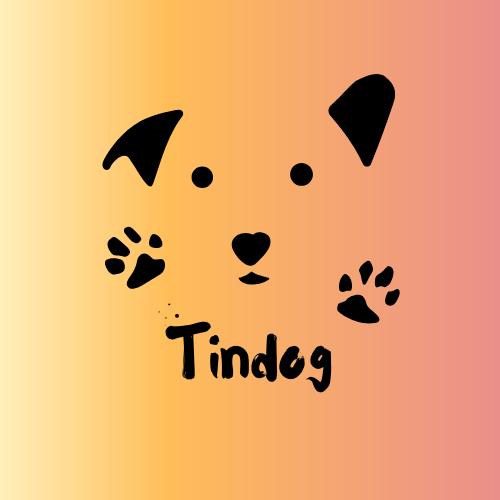
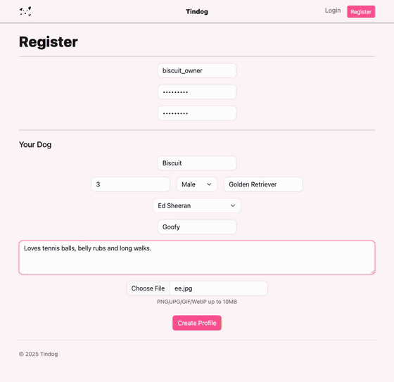
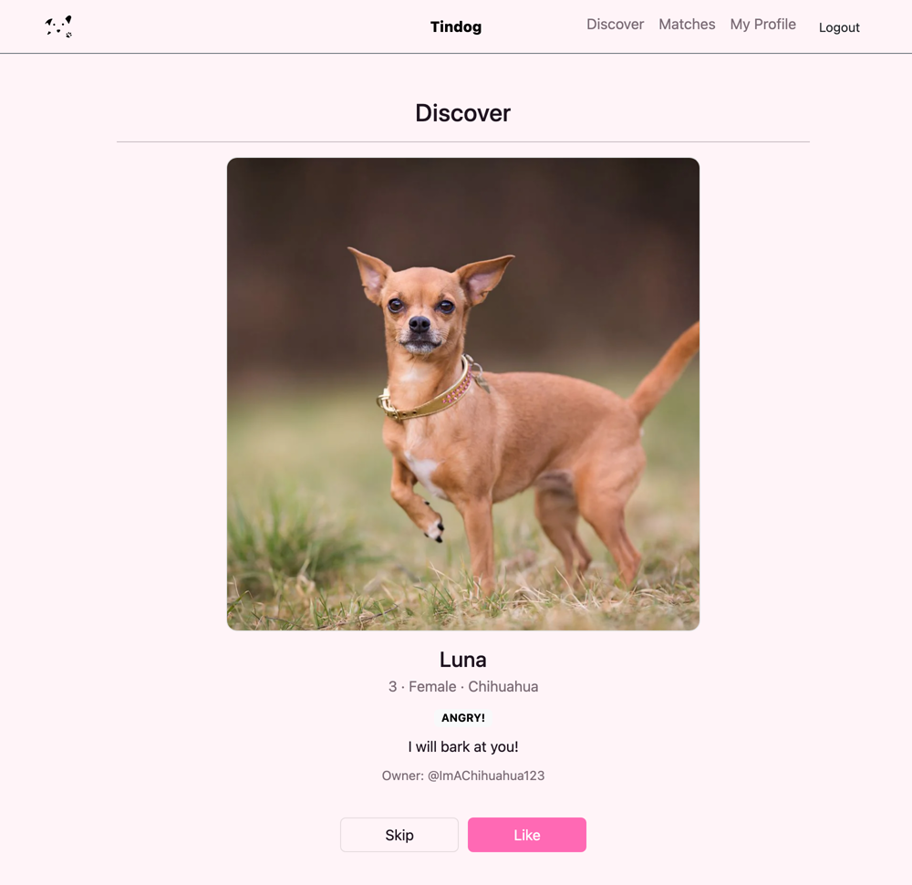
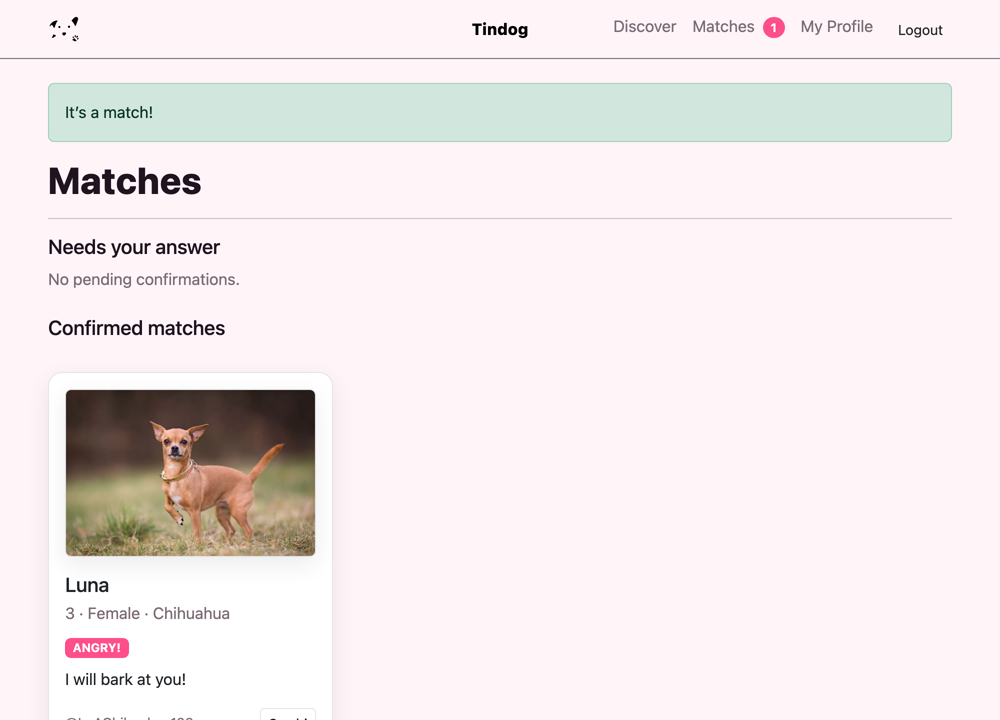
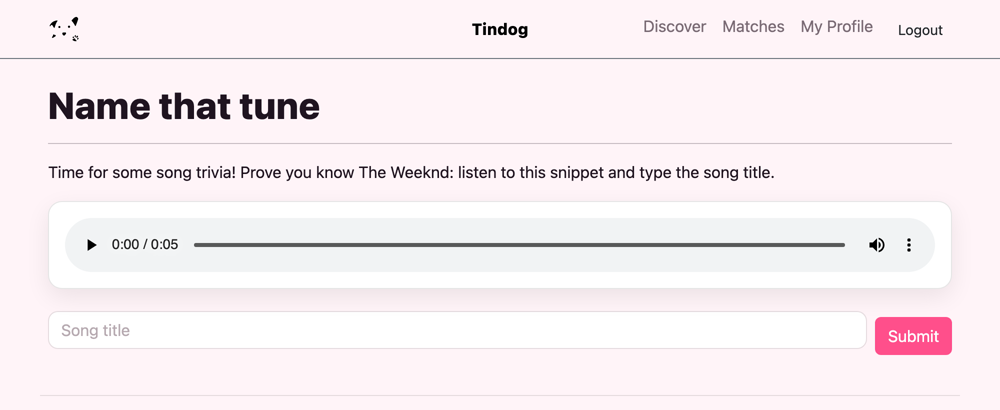

<div align="center">



# Tindog

**Tinder for dogs, with a twist: your dogs only match if you can name their favourite song.**

Built at **FallHacks 2025** by Rishon Ghosh, Jagdeep Sidhu and Gurtej Gill.

     



<sub>Luna has already liked Biscuit. Liking her back opens the song quiz, and the right answer confirms the match.</sub>

</div>

## How it works

1. **Create a profile for your dog.** Add a photo, breed, age, personality, a short bio and your dog's **favourite artist**.
2. **Discover dogs one at a time.** Like or skip each one.
3. **Pass the vibe check.** If you like a dog that has already liked yours, the match isn't confirmed yet. Tindog plays a short clip by *that dog's* favourite artist, and you have to type the song title.
4. **It's a match.** Answer correctly and the dog moves to your confirmed matches. Dogs who liked you first wait under "Needs your answer", and the count shows as a badge in the nav bar.

## Screenshots

<table>
  <tr>
    <td width="50%"></td>
    <td width="50%"></td>
  </tr>
  <tr>
    <td><b>Discover</b>: one dog at a time</td>
    <td><b>Matches</b>: confirmed matches and likes waiting on you</td>
  </tr>
  <tr>
    <td colspan="2"></td>
  </tr>
  <tr>
    <td colspan="2"><b>Name that tune</b>: the quiz that stands between a mutual like and a match</td>
  </tr>
</table>

## Under the hood

- **Matching in SQL.** Likes and skips live in one `likes` table keyed on `(user, target dog)`, with a value of `1` or `-1`. Discover, mutual matches, pending matches and the nav badge are all single SQL queries (self-joins on `likes`), and swipes are upserts (`ON CONFLICT … DO UPDATE`), so changing your mind never creates duplicate rows.
- **A gated match.** A like that would complete a match is *not* written straight away. `/swipe` detects the mutual like and redirects to the quiz first, and the like is only recorded once the answer is correct. Answers are matched case-insensitively against accepted variants (for example "Can't Stop The Feeling" and "Cant Stop The Feeling").
- **Secure basics.** Passwords are hashed with Werkzeug, every query is parameterized, protected routes go through a `login_required` decorator, and responses are sent with no-cache headers so pages don't reappear after logout.
- **Safe uploads.** Photos are checked against an extension allowlist and capped at 10 MB. Filenames go through `secure_filename`, and a numeric suffix is added if a file with that name already exists.
- **Self-initializing database.** The SQLite schema is created on start-up, and a small migration adds the `favorite_artist` column to databases created before it existed.

## My role

I wrote the application code in this repository: the Flask backend and database schema, the matching queries, the song-quiz match gate and its audio clips, every page template, and the styling. Jagdeep set up the repository and the original README. After the hackathon, I reorganized the project and rewrote the documentation.

## Getting started

Requires **Python 3**.

```bash
git clone https://github.com/rishon-g/fallhacks-tindog.git
cd fallhacks-tindog
python3 -m venv venv
source venv/bin/activate        # Windows: venv\Scripts\activate
pip install -r requirements.txt
python3 app.py
```

Then open <http://127.0.0.1:5000>. The repository includes a small demo database (`barkr.db`) with a few dog profiles, so you can register and start swiping straight away.

## Running the tests

The tests use a temporary database, so `barkr.db` is left untouched:

```bash
pip install pytest
PYTHONPATH=. pytest tests
```

## Project structure

```
app.py               # routes, matching logic, song quiz, database setup
templates/           # Jinja2 pages: discover, songgate, matches, register, login, profile
static/css/          # styles
static/audio/        # song clips for the quiz
static/uploads/      # dog photos
barkr.db             # SQLite demo database
tests/               # pytest tests (run against a temporary database)
```

## What I'd build next

- Swipe gestures and card animations
- A mobile-first layout
- Real-time match notifications and chat between matched owners
- Smarter matching: breed, size and energy level, not just music

## License

[MIT](LICENSE)
